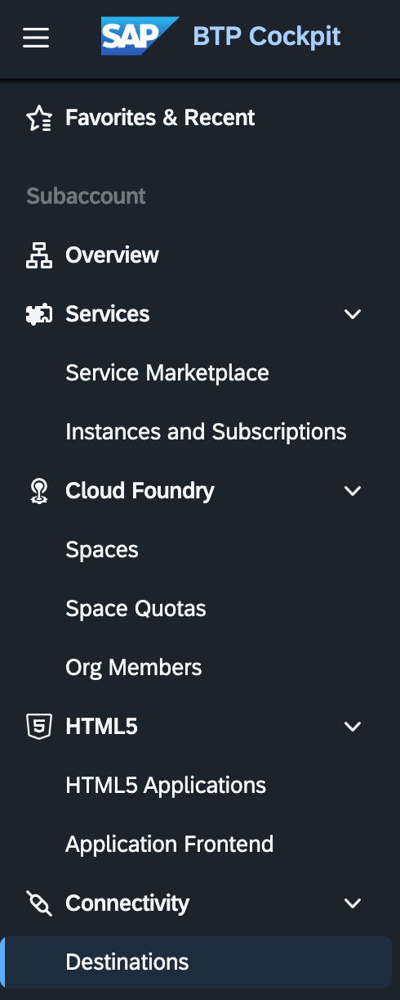
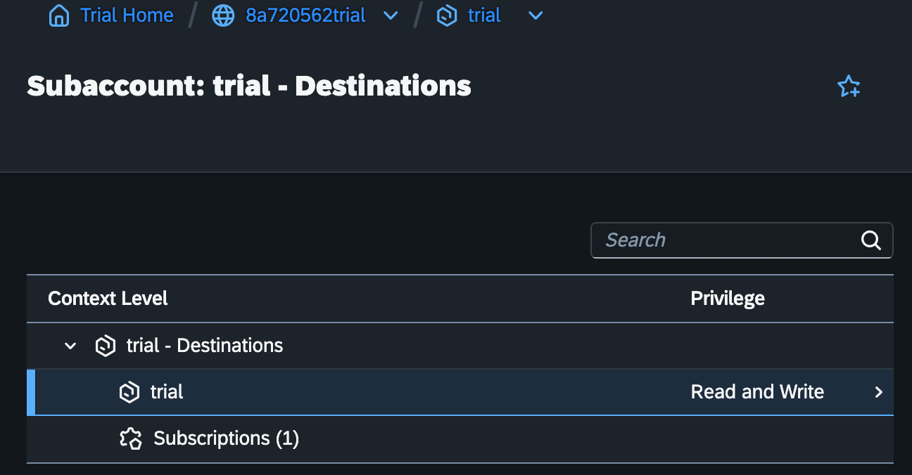
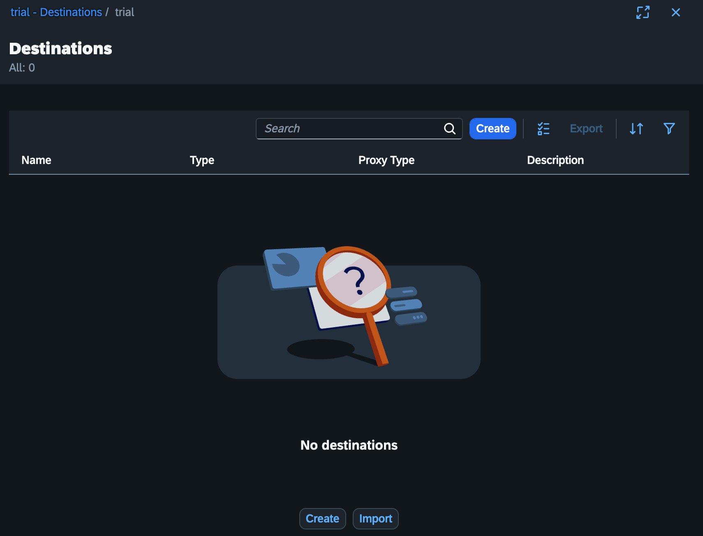
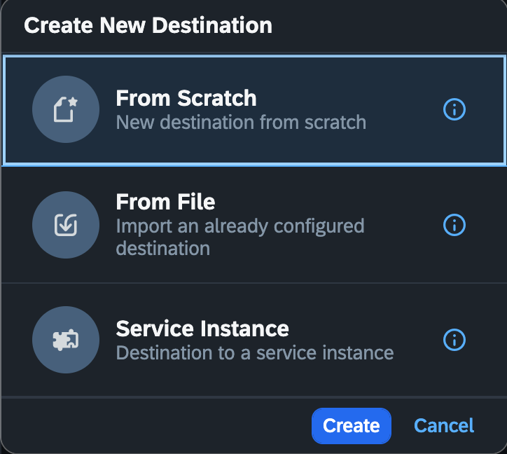
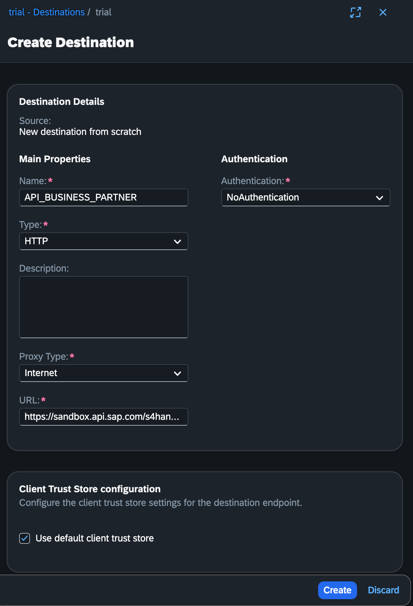
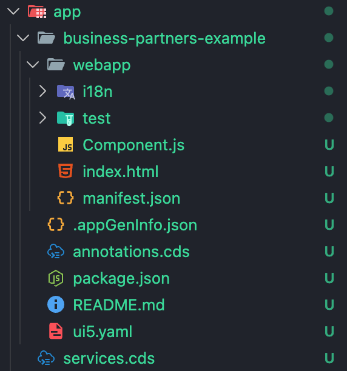

# 🔐 09 – Create Destination in SAP BTP Subaccount

This branch configures secure outbound connectivity using SAP BTP Destination service.

---

## 🎯 Objectives

- Configure Destination in BTP
- Adjust security configuration
- Enable secure external API access

---

## 📸 Screenshots

### 1️⃣ Destination Configuration

These screenshots document the complete destination setup process.

---

## 🔑 Destination Properties

Create the destination **from scratch** with these values:

| Field | Value |
| :--- | :--- |
| Name | `API_BUSINESS_PARTNER` (must match `credentials.destination` in the `[production]` profile of `package.json`) |
| Type | `HTTP` |
| URL | `https://sandbox.api.sap.com/s4hanacloud/sap/opu/odata/sap/API_BUSINESS_PARTNER` |
| Proxy Type | `Internet` |
| Authentication | `NoAuthentication` |

Then add one **Additional Property** – without it the sandbox answers `401 Unauthorized`:

| Key | Value |
| :--- | :--- |
| `URL.headers.APIKey` | your API key from the [SAP Business Accelerator Hub](https://api.sap.com/api/API_BUSINESS_PARTNER/overview) |

Locally, the `[development]` profile sends the same key from `.env`; in production the destination adds it to every request.

---

## 🧠 What You Learned

- How to configure Destinations
- How CAP connects via Destination
- How secure outbound connectivity works